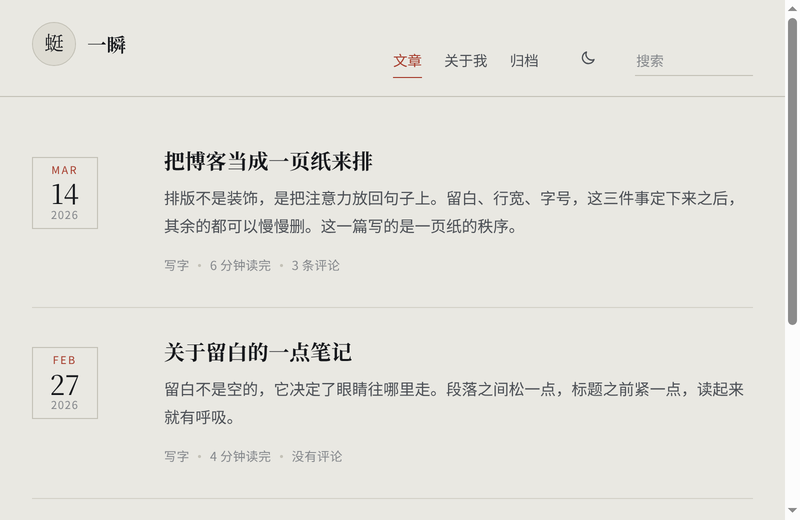

# 一瞬（Yishun）

> **⚠️ 早期版本提醒**
> 目前处于主题的初期阶段（0.1.0），排版和细节还在打磨，**可能存在显示上的 bug**。
> 遇到问题欢迎踊跃反馈 🥰 —— 直接开 [issue](https://github.com/yanjie233/yishun/issues) 就行，
> 最好带上截图、浏览器和屏幕宽度。

一页纸上的博客主题。纸色底、墨色字、一枚日期印章，没有卡片也没有阴影。

为 Typecho 1.3+ 编写，适合写字为主、配图不多的博客：正文单栏，靠字号与留白分层，
昼夜两套配色一键切换。



## 特性

- **纸感排版**：米色纸底、衬线正文、细线分隔，没有圆角与投影，阅读时只剩文字。
- **日期印章**：列表左侧一枚印章式日期（月 / 日 / 年），文章页留给标题和正文。
- **昼夜双色**：右上角一键切换，偏好存在本地，刷新不闪；`prefers-color-scheme` 只作首次默认。
- **插件友好**：走 Typecho 的 `$this->header()` / `$this->footer()` 与内容钩子，不针对某个插件写死。
- **提示框**：`{cat_tips_*}` 四类提示（成功 / 说明 / 注意 / 错误），图标随主题描边。
- **播放条**：横向一条，封面 + 曲名/歌手 + 进度；网易云曲目按需解析，失败会明确告诉你原因。
- **SEO 完备**：canonical、描述、Open Graph、Twitter Card、JSON-LD（BlogPosting / WebSite）、`sitemap.xml`。

## 环境

- Typecho **1.3.0** 及以上（用到了 1.3 的命名空间与新 widget 结构）
- PHP **8.0+**（在 8.5 上开发与测试）
- 无第三方依赖：不需要 jQuery、不需要 CDN，字体用系统自带的思源宋体/宋体回退

## 安装

**方式一：压缩包（推荐）**

下载 [Release](https://github.com/yanjie233/yishun/releases) 里的 `yishun-theme-0.1.0.zip`，
解压后得到 `yishun/` 目录，整个放进 `usr/themes/` 即可（文件名已经是 `yishun`，不用改名）。

**方式二：git clone**

```bash
cd usr/themes
git clone https://github.com/yanjie233/yishun.git yishun
```

然后后台 → 控制台 → 外观 → 启用「一瞬」。

## 主题设置

| 设置项 | 说明 |
| --- | --- |
| 头像地址 | 站名左边的小圆头像；留空则用管理员邮箱的 Cravatar |
| 页脚补充说明 | 版权行下面的一行小字 |
| 显示阅读时长 | 按正文字数估算（中文约 400 字/分钟） |
| 备案号 / 备案链接 / 公安备案 | 填了才会出现在页脚 |
| 网易云接口地址 | 自建 [NeteaseCloudMusicApi](https://github.com/Binaryify/NeteaseCloudMusicApi) 的地址，默认用作者的公共实例 |
| 网易云 realIP | 取播放地址时必须带一个国内 IP，否则接口一律返回「暂无版权」 |
| 网易云 Cookie | 想听 VIP 曲目全曲时需要，可在下面的登录页里获取 |

> 换了头像后要重新生成站点图标（见下文「工具箱」）。

## 短代码

在正文里写：

```
{cat_tips_success}内容{/cat_tips_success}     成功（info / warning / error 同理）
{cat_localmusic name="曲名" url="https://.../a.mp3"}
{cat_webmusic name="曲名" id="64293"}          网易云歌曲 ID
{cat_video key="https://.../v.mp4"}
{cat_bili p="1" key="BV1xx411c7mD"}
{cat_hide}回复后可见的内容{/cat_hide}
```

## 音乐与图标（可选）

主题自带三个小端点，都放在 `inc/` 下：

- `inc/music.php` —— 把网易云歌曲 ID 解析成歌名/歌手/封面/播放地址（带文件缓存，命中后 7ms）
- `inc/music-login.php` —— 仅管理员可见的手机号登录页，登录后把 cookie 写进主题设置
- `inc/sitemap.php` —— 动态 `sitemap.xml`，只收录 `publish` 的内容

要让 `/sitemap.xml` 生效，在 nginx 里加一段（注意别用 `snippets/fastcgi-php.conf`，它带 `try_files` 会 404）：

```nginx
location = /sitemap.xml {
    include fastcgi.conf;
    fastcgi_pass unix:/run/php/php8.5-fpm.sock;
    fastcgi_param SCRIPT_FILENAME $document_root/usr/themes/yishun/inc/sitemap.php;
    fastcgi_param HTTPS on;
}
```

站点图标由头像生成（`favicon.ico`、`icon-32/180/192/512.png`、`site.webmanifest`）：

```bash
php usr/themes/yishun/tools/make-favicon.php
```

## 目录结构

```
yishun/
├── index.php            列表页（首页 / 分类 / 标签 / 搜索 / 归档 / 作者）
├── post.php page.php    文章 / 独立页面
├── archive.php category.php tag.php author.php date.php search.php
├── 404.php comments.php header.php footer.php functions.php
├── style.css            全部样式，顶部是设计变量
├── screenshot.png
├── assets/player.js     播放条（原生 audio，不依赖 APlayer）
├── inc/                 music.php / music-login.php / music-store.php / sitemap.php
└── tools/make-favicon.php
```

## 设计变量与命名约定

`style.css` 顶部集中定义了一组变量，改它们就能整体换色：

```
--paper / --paper-lift / --paper-sink    三层底色
--ink / --ink-mid / --ink-faint          三级文字
--rule / --rule-soft                     分隔线
--stamp / --accent                       印章红 / 链接蓝
--serif / --sans                         字族
--gutter / --measure / --pad             栅格
```

类名约定：块用 `.block`、元素用 `.block-elem`（如 `.entry-title`、`.track-cover`），
状态统一 `is-*`（`.is-single`、`.is-page`、`.is-loading`、`.is-dead`、`.is-active`），
不给元素起品牌前缀。

## 许可

MIT License，见 [LICENSE](LICENSE)。
